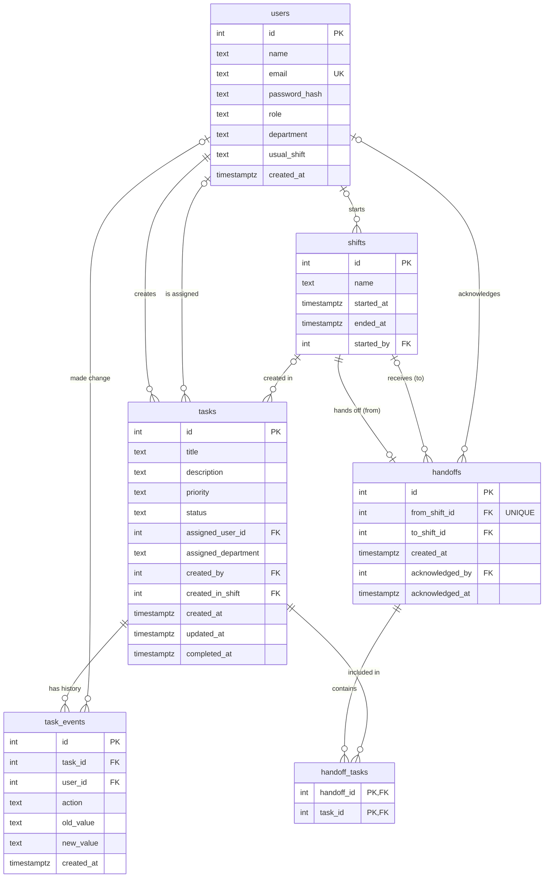

# Database

PostgreSQL 17, running in Docker. The tables are defined in [`01_schema.sql`](01_schema.sql) and the demo data is in [`02_seed.sql`](02_seed.sql).

## The 6 tables

| Table | What it's for |
|---|---|
| `users` | Everyone who logs in. `role` is `employee` or `supervisor`, `department` is e.g. Front Desk or Maintenance, and `usual_shift` is the shift they normally work. |
| `shifts` | A block of work time, such as "Evening". `ended_at` is empty while the shift is still going. Only one shift can be going at a time. |
| `tasks` | A piece of work: title, priority, status, who it's assigned to, and which shift created it. |
| `task_events` | A task's history. A new row is added every time something about a task changes; old rows are never edited. |
| `handoffs` | One shift handing over to the next. Each shift can be handed off only once. |
| `handoff_tasks` | Which tasks were included in a handoff. |

## How they connect



How to read the lines: `||` means exactly one, `|o` means zero or one, and `o{` means zero or more. For example, every task has exactly one creator, but may have no assigned user.

The database enforces these links. You can't point at a user, shift or task that doesn't exist. You also can't delete a row that something else points to, such as a user who created tasks.

## Allowed values

| Column | Allowed values | Default |
|---|---|---|
| `tasks.priority` | `low`, `medium`, `high` | `medium` |
| `tasks.status` | `open`, `in_progress`, `completed` | `open` |
| `users.role` | `employee`, `supervisor` | `employee` |
| `users.usual_shift` | `Morning`, `Evening`, `Night` | empty (no regular shift) |

These are lowercase and exact: `High`, `done` or `admin` is rejected.

The database also enforces these rules:

| Rule | Example that is rejected |
|---|---|
| Emails are unique, ignoring capitalization | `Maria.Lopez@example.com` when `maria.lopez@example.com` already exists |
| Only one shift can be active at a time | Starting a shift while another has no `ended_at` |
| A shift can't end before it starts | `ended_at` earlier than `started_at` |
| A shift can't hand off to itself | `to_shift_id` equal to `from_shift_id` |
| A shift can be handed off only once | A second `handoffs` row with the same `from_shift_id` |
| A task can appear only once per handoff | The same task twice in `handoff_tasks` |

`task_events.action` is a convention, not enforced by the database. The backend uses these actions: `created`, `assigned`, `department_changed`, `status_changed`, `priority_changed`, `title_changed`, `description_changed`, `comment`.

## How a handoff works

1. When a shift ends, a `handoffs` row is created with `from_shift_id` set to the ending shift and `to_shift_id` set to the next shift.
2. Every task that isn't completed yet gets a row in `handoff_tasks`.
3. The tasks themselves are **not copied or closed**. They stay in `tasks` with their current status, and the next shift keeps working on the same rows.
4. When someone on the next shift reads the handoff, `acknowledged_by` and `acknowledged_at` are filled in.

`handoff_tasks` is a snapshot of *which* tasks were handed over. It doesn't store their status at that moment. To see a task's status right now, look at `tasks`. To see what happened to it, look at `task_events`.

**Example from the demo data:** The Evening shift handed off 3 tasks to the Morning shift. One of them, "Approve late checkout for Room 205", was completed the next morning. It's still listed in the handoff, but its row in `tasks` now says `completed`.

## Running the database

You need Docker Desktop running. Run all commands from the project root, not from `database/`.

**First time:** copy the example settings file, then change the password in `.env`:

```bash
cp .env.example .env
```

Never commit `.env`.

**Start:**

```bash
docker compose up -d
```

The first time it starts with no data, Postgres runs `01_schema.sql` and then `02_seed.sql`, in that order. It never runs them again after that. Files in subfolders such as `tests/` are never run automatically.

**Stop (keeps your data):**

```bash
docker compose down
```

**Reset to fresh demo data:** `-v` deletes all data in the database. Use it after pulling a schema or seed change.

```bash
docker compose down -v
```

```bash
docker compose up -d
```

**Connect and run SQL by hand:**

```bash
docker exec -it shift_handoff_db sh -c 'psql -U "$POSTGRES_USER" -d "$POSTGRES_DB"'
```

Useful commands inside it: `\dt` lists tables, `\d tasks` describes a table, and `\q` quits.

**Connect from the backend or a GUI tool** such as TablePlus or pgAdmin: use host `localhost`, port `5432`, and the user, password and database from your `.env`. As a connection URL:

```
postgresql://<POSTGRES_USER>:<POSTGRES_PASSWORD>@localhost:5432/<POSTGRES_DB>
```

If port 5432 is already in use, you probably have another Postgres installed on your computer. Stop it first.

**Run the constraint tests:**

```bash
docker exec -i shift_handoff_db sh -c 'psql -q -v ON_ERROR_STOP=1 -U "$POSTGRES_USER" -d "$POSTGRES_DB"' < database/tests/constraints_test.sql
```

Every line should say `PASS`. The tests don't change any data.

## Demo data

| Table | What's in it |
|---|---|
| `users` | 9 staff, one supervisor per shift. Morning: Maria Lopez (supervisor), Aisha Khan, Tom Nguyen. Evening: Daniel Brooks (supervisor), James Carter, Priya Shah, Marcus Reed. Night: Sofia Rossi (supervisor), Leo Park. |
| `shifts` | Evening (yesterday, ended), Morning (today, ended), and Evening (today, started 1 hour ago and still going) |
| `tasks` | 6 hotel tasks, including "Room 312 AC broken" |
| `handoffs` | 1 handoff, from the first Evening shift to the Morning shift |

**Logging in:** every demo user's password is `password123`, for example `maria.lopez@example.com` / `password123`. This works right after a reset, with nothing else to run. The password is public in this repo, so use this seed for local demos only, never for a deployed database.

**Times move with the reset.** All demo times are relative to when the database was created, so the story always looks recent: Room 312 was reported "yesterday evening", and the current shift started 1 hour ago. To make the times fresh again, reset the database. The clock times won't always match the shift names. For example, if you reset at 10 AM, the current "Evening" shift starts at 9 AM.

Times are stored with their time zone, but `psql` shows them in UTC.
